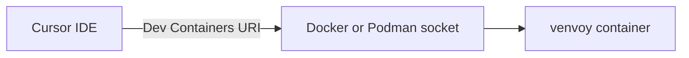

# venvoy on a local machine with Cursor

This guide walks through installing, configuring, and running venvoy on your own
computer (laptop or workstation) with the Cursor IDE. In this scenario, venvoy
starts a container on the same machine where Cursor is installed and opens
Cursor directly inside that container using the Dev Containers mechanism.

If you want a terminal-only experience without an editor, see
[README_LOCAL_TERMINAL.md](README_LOCAL_TERMINAL.md). If you are working on an
HPC cluster, see the SLURM or PBS guides listed in the main
[README](../README.md).

## When to use this scenario

- You run venvoy on the same machine where Cursor is installed.
- You have Docker (or Podman) available locally.
- You want a full IDE experience with your environment running in a container.

## How it works

Cursor connects to a locally running container using a Dev Containers URI of the
form `vscode-remote://attached-container+<container>/host-home`. This requires a
local container engine (Docker or Podman) and the container running on the same
host as Cursor. There is no network tunneling in this scenario.



## Prerequisites

- A container runtime:
  - Windows or macOS: Docker Desktop
  - Linux: Docker or Podman
- Cursor installed and available on your PATH. Download from https://cursor.sh
- No host Python installation is required when using the one-liner installer.

## Installation

### Linux, macOS, or WSL

```bash
curl -fsSL https://raw.githubusercontent.com/zaphodbeeblebrox3rd/venvoy/main/install.sh | bash
```

### Windows PowerShell

```powershell
iwr -useb https://raw.githubusercontent.com/zaphodbeeblebrox3rd/venvoy/main/install.ps1 | iex
```

After installation, restart your terminal (or run `source ~/.bashrc` or
`source ~/.zshrc`) so the `venvoy` command is on your PATH.

### Alternative: install with pipx

If you already have Python available and prefer a direct install, venvoy can be
installed with pipx (this is what the bootstrap installer uses under the hood):

```bash
pipx install git+https://github.com/zaphodbeeblebrox3rd/venvoy.git
```

## Verify your setup

Confirm venvoy is installed and see which runtime it will use:

```bash
venvoy --help
venvoy runtime-info
```

On a local machine you should see Docker (or Podman) and an HPC Environment
value of False. Make sure Docker Desktop is running before you continue.

## First-time setup

Run the one-time setup, which detects your editor and creates the venvoy home
directory used for container mounts:

```bash
venvoy setup
```

If Cursor is installed and detected, setup reports that Cursor is configured.

## Initialize an environment

Create a Python or R environment. The name you choose is used for later
commands.

Python:

```bash
# Default Python 3.11 environment
venvoy init --name my-project

# Specific Python version
venvoy init --runtime python --python-version 3.12 --name my-project
```

R:

```bash
venvoy init --runtime r --r-version 4.4 --name my-stats
```

To reinitialize an existing environment, add `--force`.

## Configuration

venvoy stores per-environment settings in
`~/.venvoy/environments/<name>/config.yaml`, including the editor selection.

If both Cursor and VSCode are installed, or you want to change the editor later:

```bash
venvoy configure --name my-project
```

Choose Cursor to enable the Cursor integration for that environment.

## Run and connect Cursor

Launch the environment. With Cursor configured, venvoy starts the container in
the background and opens Cursor connected to it:

```bash
venvoy run --name my-project
```

Your home directory is mounted at `/host-home` inside the container, and your
current working directory is mounted at `/workspace`.

### Mount additional directories

```bash
venvoy run --name my-project --mount /path/to/data:/workspace/data
```

### Run a single command instead of opening the editor

```bash
venvoy run --name my-project --command "python analysis.py"
```

## Install packages

Inside the container, use the pre-installed package managers:

```bash
# Ultra-fast Python installer
uv pip install pandas numpy matplotlib

# Standard pip
pip install some-package

# R packages
R -e "install.packages('tidyverse')"
```

venvoy automatically tracks package changes and saves environment snapshots so
your setup remains reproducible.

## Stop the environment

When you are finished, stop and remove the running container:

```bash
venvoy exit --name my-project
```

## Everyday commands

```bash
# List your environments
venvoy list

# View environment export history
venvoy history --name my-project

# Export for sharing or archival
venvoy export --name my-project --format archive

# Delete an environment
venvoy delete --name my-project
```

## Troubleshooting

- Cursor does not open: confirm `cursor` runs from your terminal, and that the
  Dev Containers/Remote extensions are installed in Cursor. venvoy falls back to
  an interactive shell if it cannot launch Cursor.
- Docker not running: start Docker Desktop (Windows/macOS) or the Docker service
  (Linux), then retry `venvoy run`.
- Permission issues on Linux: add your user to the docker group, or use Podman.
- Command not found after install: restart the terminal or source your shell rc
  file.

## Back to index

Return to the setup guide index in the main [README](../README.md).
